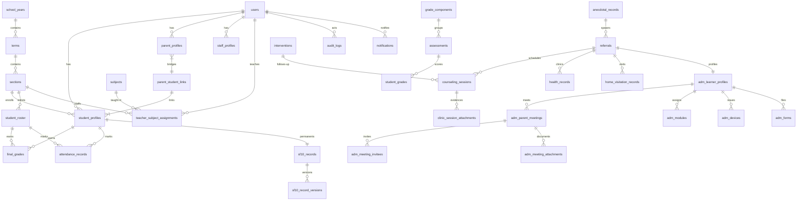

# SYSTEM_UNDERSTANDING.md — E-zentra School Management System

> Read-only onboarding snapshot. Every claim cites code evidence. Owner answers from 2026-10-11 Q&A are folded in (§6–§7).
> No audit, fix, or benchmark was performed.

---

## 1. Stack overview

| Concern | Implemented | Evidence |
|---|---|---|
| Frontend framework | Next.js `16.3.2`, React `19.2.8`, TypeScript, App Router | `frontend/package.json:33,37-39`, `frontend/src/app/*` |
| UI | Tailwind `4`, shadcn (`components.json`), radix-ui, lucide, cmdk, next-themes, `@tanstack/react-table`, recharts, dnd-kit | `frontend/package.json:11-46` |
| Client data-fetching | Axios + TanStack Query `5.101.4`; canonical `queryKey`, `CACHE_PRESETS` (`static 30m / semi 60s / live 15s`), `usePaginatedQuery` (`keepPreviousData` + next-page prefetch + `AbortSignal`) | `frontend/src/lib/api/client.ts:1-48`, `frontend/src/lib/api/queryKeys.ts:1-28`, `frontend/src/lib/api/usePaginatedQuery.ts:41-77` |
| Client auth storage | Access JWT in `localStorage: zentra.access`; refresh via httpOnly cookie (`withCredentials:true`); term scope headers `x-school-year-id` / `x-term-id` from `zentra.activeTerm`; 401 → refresh → retry → `/errors/403` | `frontend/src/lib/api/client.ts:10-23,27-56,58-106` |
| Realtime | Per-role channels + bells + booking reminder stack | `frontend/src/app/teacher/layout.tsx:32,100,182-183`, `frontend/src/app/principal/layout.tsx:21-22` |
| Backend | Node + TypeScript + Express `4`; ~20 routers under `/api`; `tsx` dev, `tsc` build | `backend/package.json:36-37`, `backend/src/app.ts:12-99` |
| DB / ORM | Prisma `7.10` + PostgreSQL on Supabase pooler (`DATABASE_URL`); 30+ tables; RLS in migration SQL, not Prisma | `backend/package.json:27-28`, `backend/prisma/schema.prisma:1-15`, `docs/backend-stack.md:35,45-48` |
| AuthN/Z | JWT access+refresh (`jsonwebtoken`), `role` + `gradeBand` claims; Argon2id; Zod validation; Helmet/CORS/Pino/`express-rate-limit`; `requireAuth`, `requireRole`, `requireOwnershipOrRole`, `gradeBandGuard` | `backend/src/lib/jwt.ts:1-42`, `backend/src/middleware/auth.ts:20-56`, `backend/src/middleware/gradeBand.ts:7-58`, `backend/src/config/env.ts:11-14`, `docs/backend-stack.md:36-43` |
| Uploads/storage | Multer + Upstash Redis + exceljs are deps; storage bucket envs parsed (`STORAGE_BUCKET`, `SF10_/REFERRAL_/CLINIC_STORAGE_BUCKET`, `OCR_WORKER_URL`) but **not wired** per backend doc; Supabase URL/keys parsed, no client instantiated | `backend/package.json:31,40`, `backend/src/config/env.ts:17-21`, `docs/backend-stack.md:45-48,60-62` |
| Server caching | (1) Upstash Redis GET-cache middleware (per-user/role/term keys + tag invalidation, fail-open); (2) `ETag` middleware; (3) DB `ReportSnapshot` fallback for heavy reports | `backend/src/lib/cache.ts:6-99`, `backend/src/lib/cacheTags.ts:1-35`, `backend/src/lib/redis.ts:1-29`, `backend/src/modules/reports/reports.routes.ts:17-28` |
| Term scoping | `attachTermScope` resolves `?termId` → `x-term-id` → `?schoolYearId`/`x-school-year-id` → active year + date-picked term (`pickCurrentTerm`) | `backend/src/app.ts:74`, `backend/src/lib/termScope.ts:35-138` |
| Hosting/config | Backend `PORT` default 4000, `WEB_ORIGIN`/`MOBILE_ORIGIN` CORS allowlist; frontend needs `NEXT_PUBLIC_API_BASE_URL`, `NEXT_PUBLIC_SUPABASE_URL/ANON_KEY` (build-inlined); `supabase/config.toml` exists; PLAN proposes Vercel (web) + Railway/Render/VPS (backend) | `backend/src/config/env.ts:4-30`, `backend/src/app.ts:43-44`, `frontend/.env.example:1-13`, `PLAN.md:47-48` |
| Tests | Vitest 2 + Supertest 7 (`npm test`), not Jest | `backend/package.json:58`, `docs/backend-stack.md:42,66` |

Known doc drift (observed): `PLAN.md:46` says bcrypt, code uses Argon2id; `docs/backend-stack.md:60-66` lists Auth/Storage/Multer/Nodemailer/Swagger as not-wired vs `PLAN.md` intent.

---

## 2. Role-by-role breakdown

Roles = Prisma `Role` enum (10 values, no super-admin found):

```
student, parent, subject_teacher, adviser, nurse, adm_coordinator,
guidance_counselor, record_keeper, registrar, principal
```

`backend/prisma/schema.prisma:17-28`. Helpers: `SELF_ROLES`, `STAFF_ROLES`, `TEACHER_ROLES`, `KNOWN_ROLES` (`backend/src/lib/roles.ts:8-23`). Grade-band roles: only `record_keeper` (7–10) and `registrar` (11–12) (`backend/src/lib/roles.ts:29-48`, `backend/src/middleware/gradeBand.ts:7-58`).

Frontend shells: `frontend/src/app/{principal,coordinator,nurse,guidance,teacher,record-keeper,registrar}/layout.tsx` + `login/*`, `register/`; **no** `app/student/*` or `app/parent/*` (confirmed by owner Q1: no student/parent web desk — login only, consumption is out-of-band/mobile).

Backend routers: `backend/src/app.ts:12-99` mounts `auth, grades, attendance, anecdotal, referrals, interventions, adm, sf10, risk, notifications, audit, overview, academics, reports, registrar(+academics), record-keeper(+academics), teacher(+grade-flags/advisory/grading), guidance, nurse, principal, my-sessions`.

### 2.1 Principal — school-wide oversight, final approvals, audit

- **Purpose:** Owns years/terms, final-signs ADM, views school-wide risk/academics/attendance, reads audit. Confidential cases status-only; owner Q3 confirms the filter is **server-side (field omission)**, per `PLAN.md:232-244` design.
- **Pages** (`frontend/src/app/principal/**/page.tsx`, shell `frontend/src/app/principal/layout.tsx`): `overview`; `academics`, `academics/assign`, `academics/schedule`, `academics/schedule/[sectionId]`; `risk`, `risk/students`, `risk/heatmaps`, `risk/heatmaps/{attendance,academics,records}`, `risk/interventions`; `adm`, `adm/referrals/all`; `reports`; `honor-roll`; `audit`; `settings`.
- **Data read:** `users`, `student_profiles` + `student_roster` (LRN-dedupe), `sections`, `staff_profiles`, anecdotal counts, `final_grades`, `attendance_records`, `adm_learner_profiles`, `referrals`, `audit_logs`, `report_snapshots`. Sensitive: grades, attendance, behavioral counts, ADM status. Overview loads full nested grade/attendance/anecdotal sets and computes risk in memory: `backend/src/modules/overview/overview.routes.ts:39-99,106-182` + second section-attendance load `:197-212`.
- **Actions:** school-year/term create + set-active + edit (audit `school_year_create/term_create/school_year_set_active/school_year_edit`); ADM principal-approve (`adm_principal_approve`); honor-roll mark awarded; report refresh; own profile/photo/palette: `PLAN.md:332-336`, `backend/src/modules/principal/principal.routes.ts:34-146`.
- **Permissions (server):** `requireRole("principal")` on overview, reports, audit, attendance `sweep-absent`, principal settings: `backend/src/modules/overview/overview.routes.ts:20-24`, `backend/src/modules/reports/reports.routes.ts:14-18`, `backend/src/modules/audit/audit.routes.ts:29,68,94`, `backend/src/modules/attendance/taking.routes.ts:112-116`, `backend/src/modules/principal/principal.routes.ts:34-45,47-58,107-119`. ADM queues allow `adm_coordinator + principal`: `backend/src/modules/adm/queues.routes.ts:19-52`.
- **Lists:** reports (filter-only, 5-min cache); audit list (paginated); risk students (15, §5); ADM referrals/all + approvals (paginated).
- **Heaviest:** overview fan-out; reports aggregation; risk heatmaps/students `take:5000` (§5).

### 2.2 Admin Coordinator (`adm_coordinator`, frontend `coordinator/`) — ADM case ownership

- **Purpose:** Reviews referred students, evaluates eligibility, prepares learner profiles, books parent meetings/home visits, tracks modules + devices, forwards to Principal: `PLAN.md:224-226`.
- **Pages** (`frontend/src/app/coordinator/**/page.tsx`): `overview`, `page.tsx` (desk root), `enrolled`, `referrals`, `referrals/[id]`, `certifications`, `devices`, `settings`. Services: `frontend/src/services/coordinator/{overview,cases,certifications}.*`.
- **Data:** `referrals` (`referredToRole=adm_coordinator`), `adm_learner_profiles` (`eligibilityStatus pending|eligible|ineligible`, `stage`), `adm_parent_meetings` (`venue school|home`, `attendees` JSON, minutes/logbook), `adm_meeting_invitees`, `adm_meeting_attachments`, `adm_modules`, `adm_devices`, `adm_forms`: `backend/prisma/schema.prisma:1048-1182`. Sensitive: certification details, minutes, home-visit context (`confidentialityLevel`).
- **Actions:** create learner profile (transfers pre-profile referral bookings), book/record meetings, log attendance + minutes, upload meeting docs, issue/return devices, certify, forward for principal approval. Stage machine `anecdotal → consultation → meeting_parents → home_visitation → certification → principal_approval → enrollment_monitoring → completion`: `schema.prisma:142-151`.
- **Permissions:** ADM queues/profiles/meetings/devices gated `adm_coordinator + principal` (queues) with status writes also open to guidance/nurse: `backend/src/modules/adm/queues.routes.ts`, `backend/src/modules/referrals/pipeline.routes.ts:39-56`. Consultation gate: only selected `consultReviewer` acts at consultation stage: `schema.prisma:873-876`. Owner Q6: `lrpc` reviewer value = committee, not a login role.
- **Lists:** `GET /api/adm/referrals/all` + `/approvals` paginated (`resolvePageSize`); `GET /api/adm/referrals` + `/history` unpaginated: `backend/src/modules/adm/queues.routes.ts:19-117`.

### 2.3 Guidance Counselor (`guidance_counselor`, frontend `guidance/`) — counseling + at-risk triage

- **Purpose:** Owns counseling referrals + engine-flagged at-risk follow-ups; schedules talks/home visits; approves interventions: `PLAN.md:222-223`.
- **Pages** (`frontend/src/app/guidance/**/page.tsx`): `overview`, `page.tsx`, `referrals`, `referrals/counseling`, `referrals/adm`, `interventions`, `alerts`, `anecdotal`, `risk`, `risk/heatmap`, `risk/behavioral`, `adm`, `session-documents`, `settings`. Services: `frontend/src/services/guidance/*`.
- **Data:** `referrals` + `counseling_sessions` + `clinic_session_attachments`, `interventions`, `risk_snapshots`, anecdotal (restricted/confidential). Sensitive: session notes/outcomes, intake notes/priority, home-visit records. Close-out rule: resolve requires ≥1 completed session (enforced in referrals routes, not just UI): `schema.prisma:924-927`.
- **Actions:** accept/intake (priority/intakeNotes/acceptedAt), schedule/complete/cancel/reschedule, file session docs, notes, follow-up, escalate/reassign/dismiss, assign/approve intervention outcomes. Statuses `pending/in_progress/resolved/escalated/info_requested/dismissed/follow_up`: `schema.prisma:100-108`.
- **Permissions:** `GET /api/guidance/referrals` + interventions queue/staff/engine are guidance-only: `backend/src/modules/guidance/cases.routes.ts:16-23`, `backend/src/modules/interventions/queues.routes.ts:17-24,62-81`. Pipeline split — status: guidance/nurse/adm_coordinator/principal; escalate/reassign/note/follow-up/dismiss: guidance-only; cancel/delete/reopen: adviser/subject_teacher: `backend/src/modules/referrals/pipeline.routes.ts:39-214`.
- **Lists:** guidance cases (paginated, `resolveGuidancePageSize`, status/type/booked/completed/open filters): `cases.routes.ts:44-65`; interventions queue (15, level/factor/mine/outcome): `queues.routes.ts:26-55`.

### 2.4 Nurse (`nurse`, frontend `nurse/`) — clinic visits + health records

- **Purpose:** Clinic visits incl. walk-ins (`health_records.referralId` nullable), visit docs, nurse-targeted referrals + ADM consultation reviews: `PLAN.md:137-140`, `schema.prisma:879-882,1012-1027`.
- **Pages** (`frontend/src/app/nurse/**/page.tsx`): `overview`, `page.tsx`, `health-records`, `alerts`, `adm`, `referrals`, `referrals/adm`, `referrals/clinic`, `risk`, `settings`. Services: `frontend/src/services/nurse/*`.
- **Data:** `health_records` (complaint/diagnosis/treatment, `confidentialityLevel`), `referrals` → `counseling_sessions` + `clinic_session_attachments` (image evidence, storage URLs + metadata). Filing closing docs auto-resolves the case: `schema.prisma:958-962`. Forwarding to ADM requires `referralFormReady` set on the dedicated form page: `schema.prisma:879-882`.
- **Actions:** record visits, schedule/complete/cancel sessions, upload attachments, nurse intake, forward ADM cases (gated).
- **Permissions:** `nurse.routes.ts` is **settings/profile + photo only** (all `requireRole("nurse")`); clinical writes go through shared referrals routes — intake nurse endpoints, sessions guidance+nurse, status guidance/nurse/adm_coordinator/principal: `backend/src/modules/nurse/nurse.routes.ts:34-143`, `backend/src/modules/referrals/intake.routes.ts:99-174`, `backend/src/modules/referrals/sessions.routes.ts:51-203`.
- **Lists:** referral queues (term+desk+status indexes); sessions caps `take:50` (`sessions.routes.ts:320,344`); notification short-poll.

### 2.5 Teacher — `subject_teacher` + `adviser` share one workspace

- **Purpose:** Subject teachers encode grades for assigned subjects; advisers add attendance, anecdotal for advisees, ADM tracking, finals lock, SF10 upload/verify: `PLAN.md:220-222`.
- **Pages** (`frontend/src/app/teacher/**/page.tsx`, shell with `TeacherSidebar`, `AdviserClaimGate`, `BookingReminderStack desk="teacher"`): `overview`, `overview/students`, `overview/reports`; `classes`; `schedule`, `schedule/[sectionId]`; `attendance`; `grading`, `grading/[assignmentId]`; `grade-flags`; `advisory/list|students|attendance|schedule|referrals|adm-cases`; `anecdotal`, `anecdotal/folders`, `anecdotal/folders/student/[studentId]`; `chat`; `settings`. Services: `frontend/src/services/teacher/*` + `frontend/src/services/anecdotal/*`.
- **Data:** `teacher_subject_assignments`, `sections` (adviser via `adviserCode` claim), `student_profiles` + `student_roster` dual reads, `grade_components`/`assessments`/`student_grades`/`final_grades`, per-subject `attendance_records`, `anecdotal_records` + `anecdotal_folders`, `referrals`, `grade_flags`, `section_timetable_entries`, `teacher_names` + `teacher_term_grants`. Sensitive: grades, attendance, anecdotal write-ups. `adviser_archived_students` hides per-adviser without deleting history: `schema.prisma:605-621`.
- **Actions:** bulk attendance (subject or legacy AM/PM), assessments/scores, compute/transmute finals, lock finals, raise grade flags, anecdotal + followups, refer to nurse/guidance/ADM/principal, cancel/delete/reopen own referrals, claim advisory via code, link timetable name via code, folders/signatures, SF10 access requests.
- **Permissions:** attendance bulk `adviser|subject_teacher` (`taking.routes.ts:13-18`); grades `subject_teacher|adviser` with adviser-only lock (`grades.routes.ts:25,147,419,450,544` + `teacher/*` grep); advisory code never exposed to teacher routes, shared out-of-band (`schema.prisma:417-420`); per-term workspace grant required (`adviser` tap-through or code): `schema.prisma:583-603`. Cross-band rule (owner Q5): split by band — each band owns its slice.
- **Lists:** students/roster/overview cached (`dashboard`/`list` TTLs); grading/attendance per-section; flags queue scoped to active term (`@@index([termId,status,ownerId])`).

### 2.6 Record Keeper (grades 7–10) — accounts + SF10 + finals validation

- **Purpose:** Approves 7–10 accounts (LRN-verified), validates SF10, receives locked finals, reviews adviser SF10-access (band-enforced): `PLAN.md:226-228`.
- **Pages** (`frontend/src/app/record-keeper/**/page.tsx`): `overview`, `final-grades`, `final-grades/[id]`, `accounts`, `adviser-access`, `sf10`, `settings`.
- **Data:** `users` (pending/active/suspended), roster-vs-profile LRN matching, `final_grades`, `sf10_records` + versions, `adviser_sf10_access_requests`, `audit_logs`. Sensitive: PII (email/contact/LRN/birthdate/address/photo), grades, SF10 payloads.
- **Actions:** approve/reject (`gradeBandGuard`), pending list, LRN match, access approve/deny, own profile/photo.
- **Permissions:** all `requireRole("record_keeper")` with `enforceBand:true` on access reads/decisions; cached + ETag: `backend/src/modules/record-keeper/record-keeper.routes.ts:43-186`; academics sub-router `requireRole("record_keeper")` (one route also `adm_coordinator`): `academics.routes.ts:168`.
- **Lists:** finals (15 + search); accounts-audit (15); overview `attachTake:100`; breakdown aggregate (unpaginated).

### 2.7 Registrar (grades 11–12) — same desk, upper band

- **Purpose:** Same as Record Keeper for G11–12: `PLAN.md:226-228`, `backend/src/lib/roles.ts:29-36`.
- **Pages** (`frontend/src/app/registrar/**/page.tsx`): `overview`, `final-grades`, `final-grades/[id]`, `accounts`, `adviser-access`, `sf10`, `settings`.
- **Data/actions:** Same entity set; overview `attach/missing/pending/bareTake:15`; `GET /students` (registrar-only band list). Owner Q2 decision: registrar access decisions **should match Record Keeper (band-locked)** — current `enforceBand:false` (`registrar.routes.ts:132-136`) vs RK `true` (`record-keeper.routes.ts:140-146`) is a flagged inconsistency to fix, not intended behavior.
- **Permissions:** overview/finals/breakdown/audit allow `registrar + record_keeper`; students + access reads/decisions + settings registrar-only: `backend/src/modules/registrar/registrar.routes.ts:46-266`. Academics sub-router `registrar + record_keeper` (one route also `adm_coordinator`): `registrar/academics.routes.ts:44-339`.
- **Lists:** finals + accounts-audit (15 + search); access-requests (status filter); breakdowns cached.

### 2.8 Student / Parent — registered, no web desk (owner-confirmed)

- **Purpose:** Self-register, link via `parent_student_links`, see `risk_level` + behavioral category flag only (never confidential write-ups/diagnoses): `PLAN.md:206-208,232-244`.
- **Pages:** only `login/students`, `login/parents`, `login/staff`, `login`, `register`. Owner Q1: confirm no web desk.
- **Data:** own profile / linked children, own finals/attendance summaries, notifications (attendance parent pings exist: `taking.routes.ts:54-62,97-105`).
- **Permissions:** `requireOwnershipOrRole` helper exists (`middleware/auth.ts:44-56`); student/parent-owned reads not traced in this pass.
- **Lists:** none on web.

---

## 3. Cross-role workflows

### 3.1 Enrollment: Registrar ↔ Record Keeper → Teacher/section assignment

1. Self-register (`student|parent|subject_teacher|adviser`) → `status=pending`: `POST /api/auth/register/:kind` (`auth.routes.ts:32-47`).
2. Band-split pending list (registrar G11-12, record_keeper G7-10; search; 15/page): `GET /api/auth/pending` (`auth.routes.ts:136-165`).
3. Optional LRN match: `GET /api/auth/match-lrn` (`:49-64`).
4. Approve/reject with `gradeBandGuard` → `audit_logs(account_approval)`: `POST /api/auth/approve|reject/:userId` (`:121-187`).
5. Roster decoupled: `student_roster` (enlisted, no account) vs `student_profiles`; breakdown reports enrolled-but-no-account by LRN: `schema.prisma:436-466`, `registrar.routes.ts:84-102`.
6. Section/adviser assignment: principal manages sections + advisory codes (`academics-sections/assign/advisers`); teacher claims via `AdviserClaimGate` (`teacher/layout.tsx:182`; `teacher/claim.routes.ts` via `advisory.routes.ts:1-12`); timetable names linked by code (`teacherName.code/userId`, `schema.prisma:559-581`).
7. Cross-band teachers split by band (owner Q5). Notifications via `fanoutNotification` (`lib/notify.ts:214` batching).

Pages: `registrar|record-keeper/overview|accounts`, `principal/academics*`, `teacher/classes|advisory/*`.

### 3.2 Student records / document requests (SF10 + adviser access)

1. Adviser uploads/verifies (`source=ocr_upload|manual|auto_populated`): `sf10/records + lifecycle` (`sf10.routes.ts:1-10`); sets `verified_by/at`.
2. Every edit appends `sf10_record_versions` + `audit_logs(sf10_update)`: `schema.prisma:1210-1220`, `PLAN.md:322-324`.
3. Record Keeper / Registrar validates (`validated_by/at`), band-split.
4. Adviser extra SF10 read (G11–12) requires request → approve/deny: `POST /api/registrar|record-keeper/adviser-access-requests/:id/approve|deny`. To-fix: registrar uses `enforceBand:false`, RK uses `true`.
5. `final_grades` + `attendance_records` feed SF10 auto-population.

Pages: `registrar|record-keeper/sf10|final-grades|adviser-access`.

### 3.3 Clinic visits: Nurse → Teacher/Guidance/Admin notifications

1. Walk-in **or** teacher referral (`referredToRole=nurse`, `consultReviewer` gate): `referrals/intake + queues`.
2. Nurse intake (priority/notes/acceptedAt) → `counseling_sessions` (`individual|parent_conference|group|home_visit`; `scheduled|completed|cancelled`).
3. `health_records` (confidential) + `clinic_session_attachments` evidence (storage URLs + metadata).
4. Closing docs auto-resolve the case: `schema.prisma:958-962`.
5. Fan-out: parent pings, adviser notices, invitee booking + 5-min card (`adm_meeting_invitees`, `schema.prisma:1105-1118`; `taking.routes.ts:54-82` pattern).

Pages/API: `nurse/referrals|referrals/clinic|health-records|alerts`, `teacher/advisory/referrals`, `POST /api/referrals/:id/status|note|follow-up`, `referrals/sessions.routes.ts`.

### 3.4 Counseling referrals: Teacher → Guidance → Principal

1. Teacher files `anecdotal_records` (+folders/signature) → `referrals` row (`PLAN.md:260-261`; `pipeline.service.ts` via `pipeline.routes.ts:16-27`).
2. Guidance triage: `GET /api/guidance/referrals` (status/type/booked/completed/open, paginated) → intake → sessions → resolve (≥1 completed session required).
3. Branches: `escalate` (principal|nurse|adm_coordinator), `reassign`, `info_requested`, `follow_up`, `dismiss`; teacher `cancel|delete|reopen`.
4. Overdue open grade flags → `escalated` for Principal after `GRADE_FLAG_ESCALATION_DAYS` (default 7): `schema.prisma:696-700`, `config/env.ts:29`.
5. Audit: `referral_status_change|accepted|escalated|reassigned|note|follow_up|dismissed|…` (`schema.prisma:181-194`).

### 3.5 Approvals: Admin Coordinator ↔ Principal (announcements = notifications, owner Q4)

- ADM certify → principal-approve concept (`PLAN.md:262-263`) → audit `adm_principal_approve`.
- Timetable: master fills `DRAFT` → `SUBMITTED` → principal `APPROVED` (only `APPROVED` materializes gradebook rows); reject → `DRAFT` + note: `schema.prisma:502-528`.
- Grade flags: any teacher raises; only gradebook owner (from `teacher_subject_assignments`) resolves.
- Finals: teacher locks → `adviser_approved` → registry validates (`LockStatus`, `schema.prisma:74-78`).
- No announcements module — notifications (web/mobile/email; email future) + invites + reminder cards are the channel (owner Q4): `notifications.routes.ts`, `docs/backend-stack.md:86-90`.

### 3.6 Bookings / appointments

- Counseling: schedule → `scheduled` → `completed|cancelled|rescheduled` + attachments; `GET /api/my-sessions/upcoming` (`sessions.routes.ts:127`, `take:50`); `BookingReminderStack` per desk.
- ADM meetings: coordinator books `school|home` once referred (even pre-profile via `referralId`); transfers to profile on creation; invitees notified; attendance/minutes/attachments logged after: `schema.prisma:1074-1136`.

---

## 4. Data model summary

### 4.1 ER overview (Mermaid)



Dual-identity pattern (`studentId XOR rosterId`, DB CHECK): `student_grades`, `final_grades`, `attendance_records`, `anecdotal_records`, `referrals`, `interventions`, `risk_snapshots` (`schema.prisma:651-665,667-694,743-778,803-842,897-922,978-1008,1239-1269`).

### 4.2 Indexes

- `users(role,status)`; `school_years(isActive)`; `terms[schoolYearId,termNumber]` unique.
- `sections(schoolYearId|gradeLevel|adviserId)`; `student_roster([lrn,schoolYearId]` unique + `gradeLevel|sectionId|schoolYearId|[schoolYearId,riskLevel])`.
- `teacher_subject_assignments(teacher,subject,section,term)` unique; `timetable[section,term,day,period]` unique + `(section,term)`; `term_grants[user,term]` unique + `(term)`.
- `final_grades([student,subject,term]|[roster,subject,term]` unique + `[roster]|[student,term]|[term])`; `student_grades([assessment,student]|[assessment,roster]|[roster])`.
- `attendance_records([student,subject,date,slot]|[roster,subject,date,slot]|[roster]|[student,term]|[section,term]|[subject,term]|[section,subject,term]|[assignment])` + legacy partial indexes (comment); `attendance_legacy([section,term]|[student,term]|[roster])`.
- `anecdotal([folder]|[datetime]|[student,term]|[roster,term]|[section,term]|[term,section,datetime]|[observer,term])`; `folders(owner)`.
- `referrals([role,status]|[role,reviewer]|[status]|[student]|[roster]|[term]|[term,role,status]|[term,status]|[term,role,reviewedAt])`; `counseling_sessions([referral]|[intervention]|[status]|[status,scheduledAt])`; `attachments([session])`.
- `interventions([roster]|[student]|[term]|[outcome]|[approval]|[assignee,outcome]|[term,approval,outcome])`.
- `adm_profiles([referral]|[student]|[stage])`; `adm_meetings([referral])`; `invitees([meeting,user]` unique + `[user])`; `meeting_attachments([meeting])`.
- `audit_logs([sourceTable,sourceId,createdAt]|[actionType]|[createdAt]|[userId,createdAt])`.
- `risk_snapshots([roster]|[student]|[term,risk*]|[term,date]|[term,flags])`; `report_snapshots([reportType,scope,termId]|[termId])`.
- `adviser_access([status]|[adviser]|[section]|[section,status])`; `notifications([userId,isRead,createdAt])`; `refresh_tokens([userId]|[expiresAt])`.
- Observed gaps (verify in migration SQL): no `@@index` lines on `health_records`, `home_visitation_records`, `sf10_record_versions`, `adm_modules/devices/forms` (`schema.prisma:1012-1182`).

### 4.3 Largest / most-queried (observed, not measured)

- Heavy writes: `attendance_records` (bulk/section/subject/day), `student_grades` (assessment × student), `notifications` (fan-out), `audit_logs` (every sensitive write).
- Heavy reads: `final_grades` (gradebook + honor-roll + SF10), `anecdotal_records` + `referrals` + `counseling_sessions` (queues), `risk/report_snapshots` (dashboards), `student_roster` + `student_profiles` (overview dedupe).
- Volume fixtures: `seed-gradebook-full`, `seed-gradebook-fill-gaps`, `seed-100-topup`, `seed-section-20`, `count-gradebook/transactions/sections` (`backend/prisma/*`).

### 4.4 Year / term, soft-delete, audit

- `school_years.isActive` → current year; `terms.termNumber 1/2/3` unique/year; downstream rows carry `termId`. Rollover rule (owner Q7): **open referrals/interventions/ADM cases + pending access requests carry over** (implementation to verify).
- No soft-delete (`deletedAt/isDeleted` only in generated internals). Adviser hide = `adviser_archived_students` (scoped, history preserved): `schema.prisma:605-621`.
- Audit append-only via `writeAudit` → `audit_logs` (`oldValue/newValue` JSON + reason); enum covers sf10/grades/attendance/anecdotal/health/home/ADM/referrals/sessions/interventions/accounts/roles/calendar/honor-roll/reports/profile/access: `schema.prisma:173-217,1222-1237`.

---

## 5. Current pagination / caching / performance snapshot

### Pagination

- Standard **15/page, max 15** both ends, envelope `{data,total,page,pageSize,totalPages}`: `backend/src/lib/pagination.ts:3-8,96-106`, `frontend/src/components/shared/pagination/constants.ts:1`.
- Paginated (15): guidance cases (`resolveGuidancePageSize`), interventions queue, ADM referrals/all + approvals (`resolvePageSize`), registry finals + accounts-audit (inline `min(…,15)`), auth pending, teacher flags queue, notifications list: `guidance/cases.routes.ts:44-65`, `interventions/queues.routes.ts:26-55`, `adm/queues.routes.ts:19-73`, `registrar.routes.ts:72-77,201-206`, `record-keeper.routes.ts:66-72,104-108`, `auth.routes.ts:136-165`, `notifications.routes.ts:17-47`.
- Exceptions: record-keeper overview `attachTake:100` vs registrar overview `15/15/15/15` (`record-keeper.routes.ts:52`, `registrar.routes.ts:56`); notifications legacy `take ≤50` for badge polls; sessions `take:50` (`sessions.routes.ts:320,344`); risk heatmap/students internally `take:5000` then in-memory slice to 15 (`riskHeatmap.service.ts:49,65`; `riskStudents.service.ts:48,104,133,238-242`).
- Unpaginated: `GET /api/adm/referrals`, `/history`, registrar `GET /students`, account-breakdown aggregates, overview cohort loads.

### Fetching + caching

- Server: Prisma handlers; GETs `cache({ttl,tags})` + `etag()`; writes `invalidateTags([...])`. TTLs `dashboard 15s / list 30s / semiStatic 300s / lookup 3600s` (`cacheTags.ts:29-35`); reports `semiStatic` + snapshot fallback (`reports.routes.ts:27`).
- Key = method + mount path + querystring + role + userId + term scope; GET-only; fail-open: `cache.ts:6-58`.
- Owner Q9 decision: **keep global `private, no-store`** (`app.ts:55-58`); the middleware default `private, max-age=30` (`cache.ts:43`) should be treated as override-to-review, not the rule.
- Client: server-side paging + `keepPreviousData` + prefetch-next; `static/semi/live` stale presets; term headers per request; 401 → refresh → retry → `/errors/403`.

### Risks noticed (observations only)

1. Principal overview: ~11 parallel queries incl. two full-cohort `findMany` with nested grades/attendance/anecdotal + second attendance load, in-memory risk compute per request (short Redis cache only): `overview.routes.ts:39-212`.
2. Risk/heatmap `take:5000` + in-memory slice — fine at seed scale, unbounded path: `riskStudents.service.ts`, `riskHeatmap.service.ts`.
3. Index gaps listed in §4.2 — verify in migration SQL.
4. Registrar `enforceBand:false` vs RK `true` — owner says match RK (fix pending, not intended).
5. Role shells are client components with no server redirect seen (`teacher/layout.tsx`, `principal/layout.tsx`); enforcement is API-side + 403 redirect. Confirm no `middleware.ts` gate is intended.
6. Honor-roll source of truth = **live queries** (owner Q8); snapshots are cache only. DepEd table source still to cite.

---

## 6. Assumptions I made (updated with owner answers)

- ~~Student/parent desks~~ → **Confirmed (Q1):** no web desk; login only.
- ~~Announcements module~~ → **Confirmed (Q4):** notifications + invites + reminders are the channel.
- ~~LRPC role~~ → **Confirmed (Q6):** committee, not a login role.
- ~~Rollover~~ → **Confirmed (Q7):** open cases + pending requests carry over (verify implementation).
- ~~Honor-roll truth~~ → **Confirmed (Q8):** live queries; snapshots are cache.
- ~~Cache-Control~~ → **Confirmed (Q9):** keep `no-store` globally.
- ~~RLS~~ → **Confirmed (Q10):** applied + tested (re-verify before live confidential data per PLAN O1).
- Remaining minor assumptions: `adviser` vs `subject_teacher` is a workspace mode (same `teacher/*` pages; powers from `isAdviser`/claim/assignments); nurse desk logic lives mostly in shared referral/session routes (`nurse.routes.ts` is settings-only); seed/count scripts are dev fixtures.

---

## 7. Questions for the owner — resolved 2026-10-11

| # | Question | Answer |
|---|---|---|
| Q1 | Student/parent web desk? | Confirm no web desk |
| Q2 | Registrar `enforceBand:false` vs RK `true`? | Should match RK (band-locked) → fix pending |
| Q3 | Principal status-only server or UI? | Server-side filter |
| Q4 | Announcements feed expected? | Sufficient as-is (notifications) |
| Q5 | Cross-band teacher ownership? | Split by band |
| Q6 | `lrpc` reviewer role? | Committee, no login |
| Q7 | Term rollover for open cases/requests? | Carry over |
| Q8 | Honor-roll source of truth? | Live queries |
| Q9 | `no-store` vs `max-age=30`? | Keep no-store |
| Q10 | RLS applied/tested (PLAN O1)? | Applied + tested |

Follow-ups for the fix phase (not started): cite the DepEd transmutation table source; point to the server-side principal field filter; confirm rollover carry-over implementation; align registrar `enforceBand` with RK.
