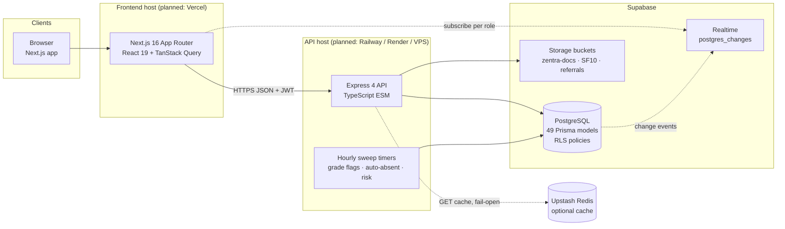
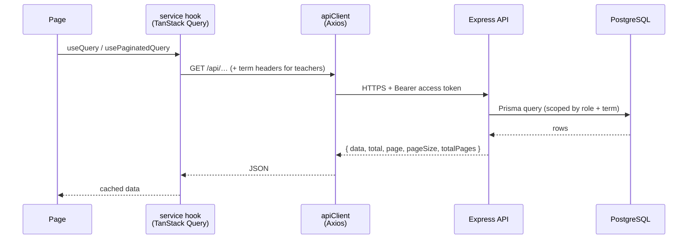
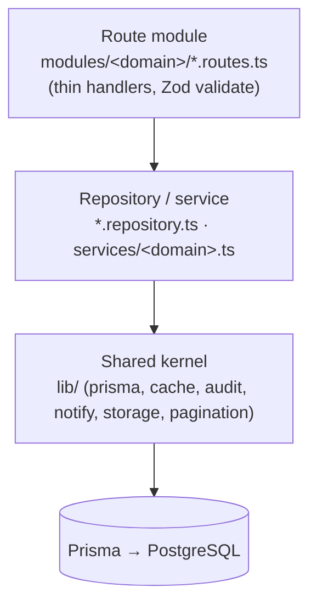
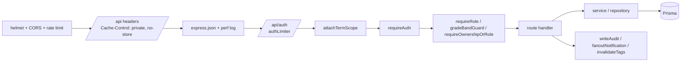

# Zentra — System Architecture

> **Scope:** how the pieces of Zentra fit together — the runtime topology, the
> frontend and backend layers, the data model, and the cross-cutting concerns
> (auth, term scoping, caching, realtime, audit, storage).
>
> **Audience:** developers, reviewers, and thesis panels who need the technical
> picture rather than a per-role feature walkthrough. For role features see
> [`../guides/user-guide.md`](../guides/user-guide.md); for setup see
> [`../guides/developer-guide.md`](../guides/developer-guide.md).

---

## 1. What Zentra is

Zentra is a **Student Information & Management System** for Mati School of Arts
and Trades, covering Grades 7–12 on a **trimester calendar** (three terms per
school year). It is a two-application monorepo:

| Application | Path | Responsibility |
|---|---|---|
| **Web client** | `frontend/` | Role-aware UI: 8 staff desks, a student portal, auth, print views |
| **REST API** | `backend/` | Business rules, RBAC, persistence, background sweeps, notifications |

Supporting services are managed, not self-hosted: **Supabase** (PostgreSQL +
Storage), **Upstash Redis** (optional response cache), and Supabase
**Realtime** (`postgres_changes`).

---

## 2. System context



Runtime characteristics:

- The browser never talks to PostgreSQL directly. Storage URLs and realtime
  subscriptions are the only direct Supabase touchpoints, both guarded by the
  API-issued session.
- Redis is **optional**. If it is absent or unreachable the cache layer
  fail-opens and the API serves straight from PostgreSQL.
- The three hourly sweeps run inside the API process (`backend/src/index.ts`),
  so deploying more than one API instance would run them redundantly — a
  scaling caveat noted in §12.

---

## 3. Frontend architecture

**Stack:** Next.js 16 (App Router), React 19, TypeScript, TanStack Query 5,
Axios, Tailwind 4 + shadcn/radix, CSS Modules, zod.

### 3.1 Route tree

```
frontend/src/app/
├── layout.tsx / page.tsx        # public landing
├── login/{,staff,students,parents}
├── register/
├── errors/[code]/               # 403 / 404 / 500 surfaces
├── (print)/record/…             # print record sheets (no app chrome)
├── student/                     # learner portal: modules + submissions
├── teacher/                     # overview, classes, grading, attendance,
│                                # anecdotal, advisory, schedule, settings
├── guidance/                    # overview, alerts, risk, referrals,
│                                # interventions, anecdotal, session docs, ADM
├── nurse/                       # overview, alerts, referrals, health records, ADM
├── coordinator/                 # overview, enrolled, referrals, certifications, devices
├── record-keeper/               # overview, accounts, adviser access, final grades, SF10
├── registrar/                   # same desk, banded to Grades 11–12
└── principal/                   # overview, academics, risk, honor roll, ADM, audit, reports
```

Each staff shell is a route group with its own `layout.tsx` (sidebar + topbar),
feature folders, and page-local `components/`. Pages are client components that
compose service hooks.

### 3.2 Data flow



Key frontend modules:

| Concern | Location |
|---|---|
| HTTP client, token handling, single-flight refresh | `src/lib/api/client.ts` |
| Query keys + cache presets | `src/lib/api/queryKeys.ts` |
| Paginated list hook (prefetch, AbortSignal) | `src/lib/api/usePaginatedQuery.ts` |
| Optimistic mutations | `src/lib/api/useOptimisticMutation.ts` |
| Session + role guard | `src/lib/auth/` |
| Term selection + storage | `src/lib/term/` |
| Realtime invalidation channels | `src/lib/realtime/*Channel.ts` |
| API calls and hooks per role | `src/services/<role>/` |
| Status label tones | `src/lib/labels/status-tone.ts` |

### 3.3 Auth and refresh behaviour

1. Login returns a JWT access token (kept in memory/localStorage
   `zentra.access`) and sets a refresh token in an **httpOnly cookie**.
2. `apiClient` attaches the access token to every request.
3. A `401` triggers a **single-flight refresh** — concurrent failures share one
   refresh call — then the original request is retried once.
4. A failed refresh clears the session and redirects to `/errors/403`.

The frontend guards are cosmetic; every rule is enforced again server-side.

---

## 4. Backend architecture

**Stack:** Node.js, Express 4, TypeScript (ESM — relative imports end in `.js`),
Prisma 7 with the `@prisma/adapter-pg` driver, Zod, pino, helmet, CORS,
rate limiting, Multer, argon2id, `@upstash/redis`.

### 4.1 Layering



Rules:

- Route handlers stay thin: parse with `validate(schema)`, call a
  repository/service, return JSON.
- Domain logic lives in `services/` so it can be reused across modules and
  tested without HTTP.
- Shared infrastructure lives in `lib/` and is imported everywhere.

### 4.2 Request lifecycle



Middleware order and every router mount live in **`backend/src/app.ts`** — the
single source of truth for the API surface.

### 4.3 Domain modules

| Module | Mount | Responsibility |
|---|---|---|
| `auth` | `/api/auth` | Register (student/parent/staff), login/refresh/logout, pending approvals, LRN matching |
| `grades` | `/api/grades` | Components, weights, assessments, scores, transmutation, finals lock |
| `attendance` | `/api/attendance` | AM/PM and per-subject taking, sweeps, rates, heatmaps, legacy tables |
| `anecdotal` | `/api/anecdotal` | Confidential records, folders, signatures, OCForm-01 workbook |
| `referrals` | `/api/referrals` | Intake, queues, triage pipeline, sessions, attachments, timeline |
| `interventions` | `/api/interventions` | Intervention queue, case sessions, approvals, outcomes |
| `adm` | `/api/adm` | Profiles, meetings, attachments, modules, devices, stage machine, principal sign-off |
| `sf10` | `/api/sf10` | Records, versions, verify → validate → release, OCR uploads |
| `risk` | `/api/risk` | Rule-based flags, snapshots, dashboards, heatmaps |
| `notifications` | `/api/notifications` | In-app notification feed and read state |
| `audit` | `/api/audit` | Audit log reads for oversight roles |
| `overview` | `/api/overview` | Role-specific dashboard aggregates |
| `academics` | `/api/academics` | Sections, subjects, assignments, advisers, schedules, honor roll |
| `reports` | `/api/reports` | School-wide report generation + snapshots |
| `registrar` | `/api/registrar` | G11–12 records desk (accounts, finals, SF10, adviser access) |
| `record-keeper` | `/api/record-keeper` | G7–10 records desk (same surface, banded) |
| `teacher` | `/api/teacher` | Overview, roster, grading workspace, advisory, timetable, settings |
| `guidance` | `/api/guidance` | Alerts, referrals, anecdotal, schedule, session docs |
| `nurse` | `/api/nurse` | Clinic queues, health records, ADM consultation |
| `principal` | `/api/principal` | School year/term management, ADM approval, settings |
| `student` | `/api/student` | Learner's released modules and submissions |
| `sessions` | `/api/my-sessions` | Counseling / clinic session documents for the signed-in actor |

`GET /health` is unauthenticated and used for liveness checks.

---

## 5. Data architecture

**Schema:** `backend/prisma/schema.prisma` — 49 Prisma models, no `@map`
(Prisma names are the database names). Migrations are timestamped SQL under
`backend/prisma/migrations/`; RLS policies are in
`backend/prisma/migrations/0001_rls.sql` and applied manually.

### 5.1 Identity model

```
User (role, status, credentials)
├── StudentProfile ──┐
├── ParentProfile    │  ParentStudentLink
└── StaffProfile     │
                     │
StudentRoster ───────┘   (enlisted learner without an account yet)
```

**Dual-identity pattern:** transactional rows point at *either* a
`StudentProfile` (`studentId`) *or* a `StudentRoster` (`rosterId`), enforced by
a database CHECK constraint. This lets a learner exist — with attendance,
grades, and risk — before they ever get a login. Tables using this pattern
include `StudentGrade`, `FinalGrade`, `AttendanceRecord`, `AnecdotalRecord`,
`Referral`, `Intervention`, and `RiskSnapshot`.

### 5.2 Academic spine

```
SchoolYear → Term (3 per year)
           → Section / Subject
           → TeacherSubjectAssignment
           → GradeComponent → Assessment → StudentGrade → FinalGrade
AttendanceRecord (+ legacy AM/PM tables)
AnecdotalRecord → Referral → CounselingSession / HealthRecord / HomeVisitationRecord
                          → AdmLearnerProfile → AdmParentMeeting / AdmModule / AdmDevice / AdmForm
Sf10Record → Sf10RecordVersion (append-only)
```

### 5.3 Key enums

`Role` (10 values), `UserStatus`, `GradeLevel` (G7–G12), `RiskLevel`,
`Confidentiality` (restricted | confidential), `AttendanceStatus`, `Session`
(AM | PM), `ComponentType` (WRITTEN_WORK | PERFORMANCE_TASK | EXAM), `LockStatus`
(unlocked | locked | adviser_approved), `ReferralStatus` (7 values), `AdmStage`
(8 stages), `AdmEligibility`, `Sf10Status`, `Sf10Desk`,
`AccessRequestStatus`, `GradeFlagStatus`, `ApprovalStatus`, `OutcomeStatus`.

Full entity-relationship diagrams live in
[`../zentra-erd-full.mmd`](../zentra-erd-full.mmd) (Mermaid) and
[`../zentra-erd-full.drawio`](../zentra-erd-full.drawio) (draw.io), with notes in
[`../zentra-erd-notes.md`](../zentra-erd-notes.md).

---

## 6. Authentication and authorization

### 6.1 Authentication

- **Passwords:** Argon2id.
- **Access token:** short-lived JWT signed with `JWT_ACCESS_SECRET`; claims are
  `sub`, `role`, `gradeBand`.
- **Refresh token:** opaque, rotated, stored httpOnly; persisted in
  `RefreshToken` so sessions can be revoked.
- **Registration:** students and parents self-register; staff registrations are
  approved by the banded records desk (registrar G11–12, record keeper G7–10).
  LRN matching links incoming learners to existing roster rows.

### 6.2 Authorization layers

| Layer | Mechanism |
|---|---|
| **Route access** | `requireAuth`, `requireRole(...roles)` |
| **Object access** | `requireOwnershipOrRole` (e.g. a teacher editing their own section) |
| **Grade band** | `gradeBandGuard` — record keeper G7–10 vs registrar G11–12 |
| **Term scope** | `attachTermScope` — resolves or validates the active term per role |
| **Confidentiality** | Status-only projection for principals; confidential detail restricted to guidance/nurse/author |
| **Database** | Row-level security policies (`0001_rls.sql`) as defence in depth |

### 6.3 Term scoping

Only **term-steering roles** (`subject_teacher`, `adviser`, `principal`) may
choose a term via `?termId` / `?schoolYearId` or the `x-term-id` /
`x-school-year-id` headers. Every other role has its term resolved server-side:
the active school year plus the date-matched term.

The principal stores one selected scope in `/principal/settings`, and all
principal pages follow it. `GET /api/reports` is the documented exception: it
accepts explicit `termId` / `schoolYearId` query parameters for the reports
scope picker, validating them in the service.

---

## 7. Cross-cutting concerns

### 7.1 Caching

- **Redis GET cache** keyed by method + path + query string + role + user +
  term scope. TTLs: dashboard 15 s, list 30 s, semi-static 300 s, lookups 1 h.
- **Tag invalidation** (`lib/cacheTags.ts`): mutations call
  `invalidateTags([...])` so related list/dashboard keys drop together.
- **ETag middleware** for conditional GETs.
- **Report snapshots** (`ReportSnapshot` table) as a database fallback for
  expensive reports.
- **Fail-open:** with no Redis, caching is simply off.

### 7.2 Pagination

All list endpoints are **server-paged at 15**, returned as
`{ data, total, page, pageSize, totalPages }`. Two guidance-desk boards allow
**16 per page** because they render a 4×4 card grid (referral nurse queues and
the guidance interventions queue). Desk services that merge several sources
load each source up to `INTERNAL_AGGREGATE_ROW_CAP` (400) and page the merged
list themselves. The frontend uses the shared `Pagination` component and
`usePaginatedQuery` (keeps previous data, prefetches the next page).

### 7.3 Realtime

Each role shell subscribes to Supabase `postgres_changes` channels
(`frontend/src/lib/realtime/*Channel.ts`) and invalidates the matching TanStack
Query keys. The API remains the authority for what a role may read; realtime
only signals *that something changed*.

### 7.4 Notifications

`fanoutNotification` (`backend/src/lib/notify.ts`) maps a
`source_table:action` key to a notification type via `TYPE_MAP`. Callers never
pass arbitrary type strings. Notifications are persisted per user and pushed
through the role channels.

### 7.5 Audit

`writeAudit` (`backend/src/lib/audit.ts`) records sensitive reads and writes.
When called inside `prisma.$transaction`, it must receive the transaction client
or it fails loudly — this keeps the audit row atomic with the change it
describes.

### 7.6 Storage

Supabase Storage through `lib/storage.ts`. Buckets: `STORAGE_BUCKET`
(`zentra-docs`), `SF10_STORAGE_BUCKET`, and `REFERRAL_STORAGE_BUCKET` (falling
back to `CLINIC_STORAGE_BUCKET`, then `STORAGE_BUCKET`). Missing buckets are
auto-created (public) and public URLs are returned. Uploads are size- and
type-restricted by `lib/upload.ts`.

### 7.7 Background sweeps

Started from `backend/src/index.ts`, hourly:

| Sweep | Effect |
|---|---|
| Grade-flag escalation | Flags learners below grade thresholds, escalates stale flags |
| Auto-absent | Marks unrecorded attendance as absent after the cutoff |
| Risk snapshots | Recomputes risk levels and stores a snapshot for trends |

---

## 8. API conventions

- Base path `/api/*`, JSON in/out.
- Errors: `AppError(status, CODE, message, fields?)`; Prisma errors are mapped
  in `lib/errors.ts` (`P2002 → 409 DUPLICATE`, `P2003 → 400`, `P2025 → 404`,
  connection errors → `503`).
- Validation: Zod schemas in `*.schemas.ts`, applied with `validate`.
- List envelope: `{ data, total, page, pageSize, totalPages }`.
- Dates: ISO-8601 strings; terms/school years referenced by ID.
- Caching: `Cache-Control: private, no-store` globally; ETags on eligible GETs.

---

## 9. Deployment topology (planned)

No production deployment is committed in this repository. The intended shape:

| Piece | Target |
|---|---|
| Frontend | Vercel — `NEXT_PUBLIC_*` values are build-time inlined |
| Backend | Railway / Render / VPS — stateless Express process + sweeps |
| Database | Supabase PostgreSQL (pooler connection) |
| Storage | Supabase Storage |
| Cache | Upstash Redis (optional) |
| CI | GitHub Actions: generate → migrate (main only) → typecheck → test → build |

> **Operational warning:** CI runs `prisma migrate deploy` against the live
> database on every push to `main`. Treat migrations as production operations.

Environment variables are validated at boot by `backend/src/config/env.ts`
(fail-fast Zod schema) and documented in `.env.example` for both apps.

---

## 10. Security and privacy

- Helmet security headers, CORS allowlist (`WEB_ORIGIN`, `MOBILE_ORIGIN`),
  rate limiting on auth and general routes.
- Confidential data (anecdotal records, referrals, health records, ADM) is
  restricted by role and by confidentiality tier; principals see status only.
- Every sensitive action is audited; SF10 versions are append-only.
- RLS policies provide a second enforcement layer below the API.
- Secrets stay server-side; only `NEXT_PUBLIC_*` values ship to the browser.

---

## 11. Testing and quality gates

| Gate | Command | Scope |
|---|---|---|
| Backend typecheck | `npm run typecheck` | strict TS, ESM |
| Backend tests | `npm test` | Vitest + Supertest, no live DB |
| Frontend typecheck | `npx tsc --noEmit -p tsconfig.json` | Next.js types |
| Frontend lint | `npm run lint` | ESLint + React Compiler gate |
| Builds | `npm run build` | both apps |

CI runs all of the above on pull requests and on `main`.

---

## 12. Known limitations and technical debt

- **Parent portal:** parent accounts work, but no parent desk exists yet.
- **Student portal:** module release/submission is live; broader learner views
  are still growing.
- **Deployment:** target topology is planned, not provisioned.
- **Mobile:** separate branches, not part of this tree.
- **E2E:** Playwright is installed but there is no end-to-end suite.
- **Multiple API instances:** hourly sweeps would run per instance; a leader
  election or external scheduler is required before horizontal scaling.
- **Doc drift:** older audits describe issues already fixed; prefer the current
  code, this document, and `AGENTS.md`.

---

## 13. Where to go next

- Role feature guide — [`../guides/user-guide.md`](../guides/user-guide.md)
- Setup and conventions — [`../guides/developer-guide.md`](../guides/developer-guide.md)
- ERD — [`../zentra-erd-full.mmd`](../zentra-erd-full.mmd)
- Original plan and design decisions — [`../../PLAN.md`](../../PLAN.md)
- Full documentation index — [`../README.md`](../README.md)
